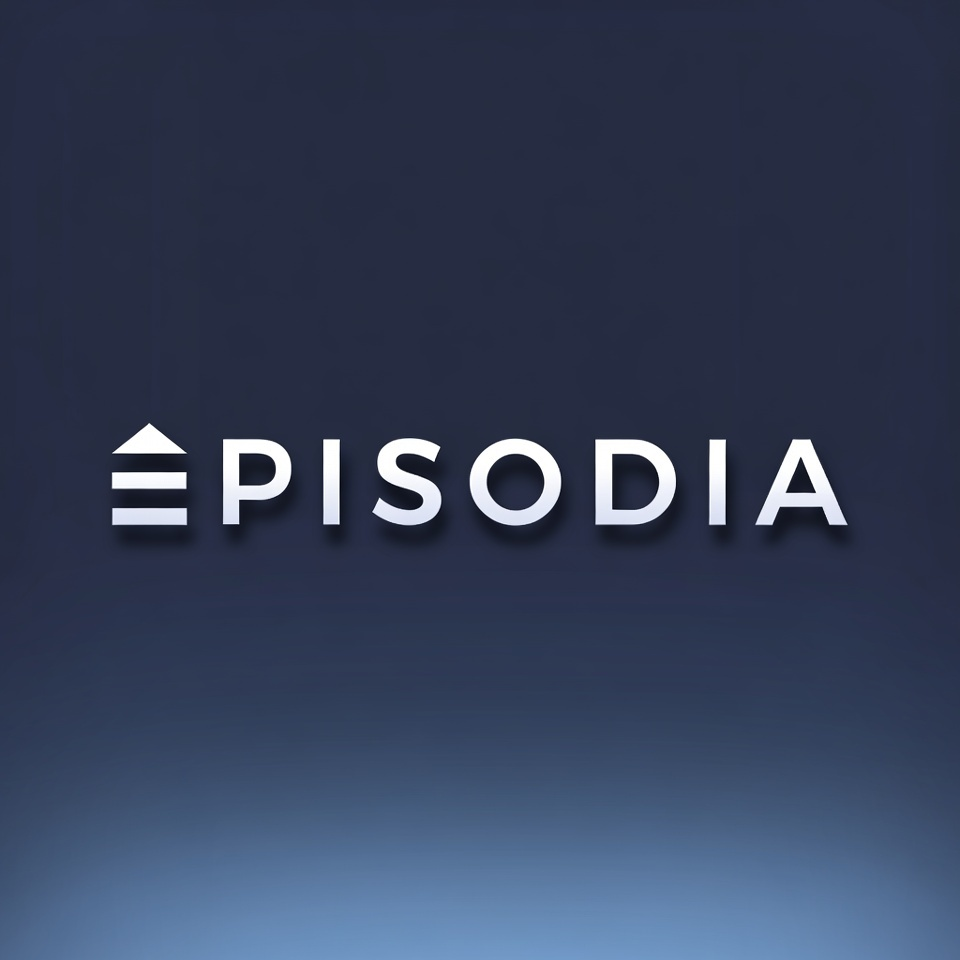

# EPISODIA

> Formerly 개추 트래스 (renamed to EPISODIA in 1.1.0).

**EPISODIA** is a Korean-first cinematic episode board for Windows by EX Inc.

Add any number of pictures or art from your Downloads folder onto the board. EPISODIA composes them into a widescreen episode: opening title card, sequential scenes with slow pan/zoom and crossfades, and an end card. Play a preview on the board, then export an MP4 back to Downloads. No image limit.

- UI language: Korean
- Episode title accepts Hangul, Japanese (kana/kanji), and English — fonts bundled (Noto Sans KR + Noto Sans CJK KR)
- Top bar: ⌂ EPISODIA maker first, 에피소드 watching second; opens on the maker board. 에피소드 home still holds the featured episode and your exports
- Optional **TTS SUBTITLES** on every scene: type a line (Korean, Japanese, or English) and it is burned in as a caption and narrated in the exported MP4. Leave it empty and that scene stays silent with no caption. Scenes stretch so speech is never cut off. Neural voices need an internet connection at export; offline it falls back to installed Windows voices.
- Reorder scenes, remove one, or clear the board
- Per-user install, no admin needed

## Install
Download `EPISODIA-Setup-1.1.0.exe` from [Releases](https://github.com/Teobokki/gaechu-trass/releases/latest). Or unzip the portable build and run `EPISODIA.exe`.

## Credits
Fonts: Noto Sans KR / Noto Sans CJK KR (SIL Open Font License, `fonts/OFL.txt`).

©2026 EX Inc./HYPERION DIGITAL ©2026
